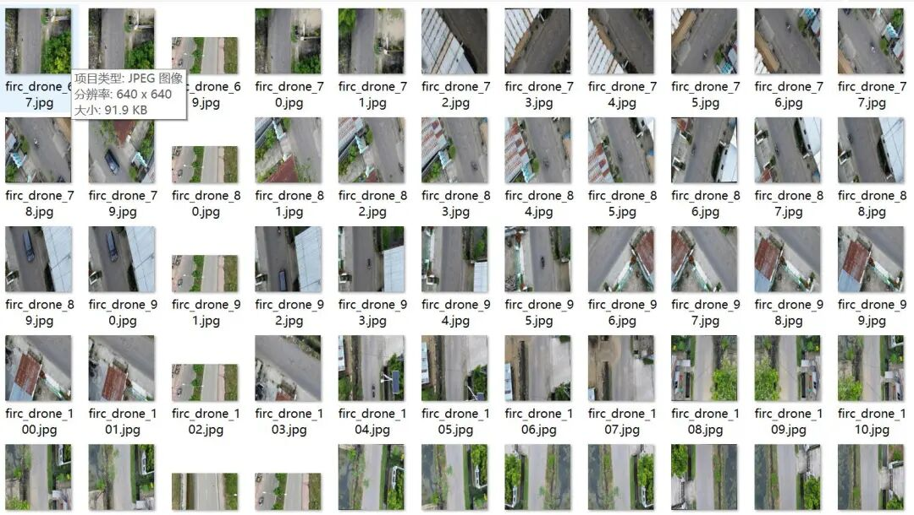
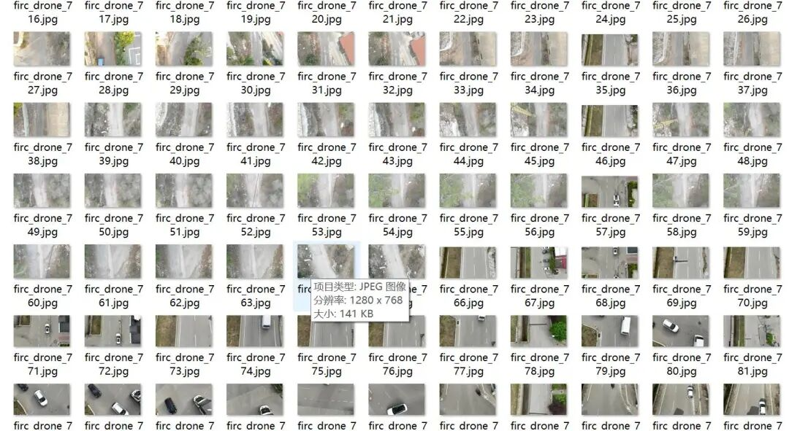
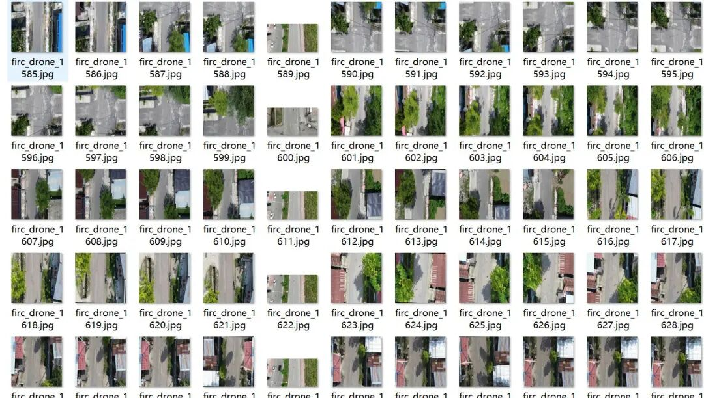
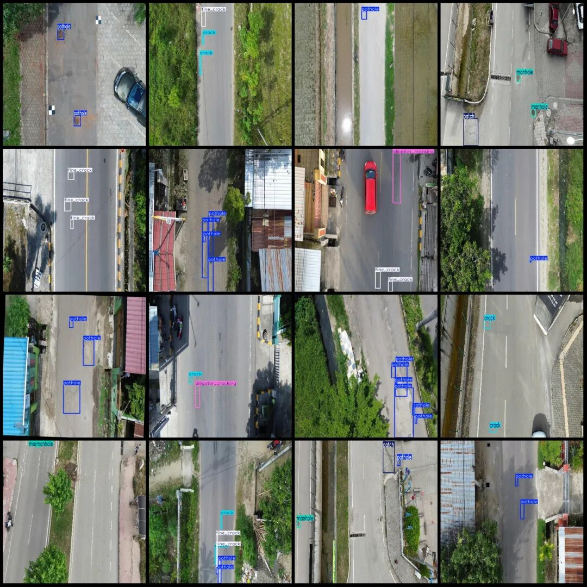

# Dataset of drone-viewpoint aerial photography for road surface pits and manhole covers crack detection in VOC+YOLO format with 1687 images across 6 categories

Please note that the dataset contains many images formed by extracting frames from videos.

Dataset format: Pascal VOC format + YOLO format (txt file without split path, only containing jpg images and corresponding VOC format xml files and yolo format txt files)

Number of images (number of jpg files): 1687

Number of annotations (number of xml files): 1687

Number of annotations (number of txt files): 1687

Label count: 6

Label category names (note that the order of yolo format categories does not correspond to this, but is based on the labels folder's classes.txt): ["alligator_cracking", "crack", "fine_crack", "manhole", "patch", "pothole"]

Number of boxes labeled in each category:

Alligator_cracking (Crocodile leather crack) Frames = 371

Crack (cracks) = 684

fine_crack (fine crack) frame count = 504

Manhole (Hole Cover) Frame Count = 211

Patch (Road patch) Frames = 139

Pothole (Pit) Frame Count = 3509

Total frame count: 5418

Drone: DJI MAVIC 3

Data Type: Raw Image + XML Tags

Collection height: 5~30m

Sampling angle: 60°~90°

Image resolution: Multi-resolution, such as 640x640, 1920x1080, 1280x768, etc.

Using labelImg:

Annotation rules: Draw a rectangle around the category.

Important Notice: No

Special : This dataset does not guarantee the accuracy of the trained models or weight files.

Image Preview:

Annotation example:

## Payment

Here is a pay link on Stripe ( https://buy.stripe.com/3cs8yP7sY87d0vu9AB ). Please contact me lonlonago@foxmail.com after funding $89, and I will send you a complete data files , thank you!

